 

---

## <code>whoami</code>

<pre>
Computer Science student and hands-on builder.
Interested in dependable software, backend systems, data workflows,
and the engineering details that make products feel considered.
</pre>

I learn by understanding fundamentals, building something real, testing the edges, and improving the result. Clear architecture, thoughtful user experience, and maintainable code are the standard.

## <code>stack --show</code>

<pre>
LANGUAGES       Python · C · C++ · Java · JavaScript · SQL
BACKEND + DATA  FastAPI · PostgreSQL · SQLite · Supabase · NumPy · Pandas
SYSTEMS + TOOLS Linux · Git · GitHub · VS Code · Android tooling
</pre>

## <code>focus --now</code>

<pre>
01  Reliable backend services and clear API boundaries
02  Data structures, algorithms, and deliberate problem solving
03  Applied machine learning and data analysis foundations
04  Polished Android and web experiences
05  Linux, networking, and system behaviour
</pre>

## <code>repositories --browse</code>

## <code>metrics --live</code>

  

Automatically refreshed from public GitHub data.

## <code>activity --signal</code>

  
  

  

  

## <code>contributions --stream</code>

  

---

<code>madhav@github:~$ contact --open</code>

  

[Portfolio](https://www.madhav.world/) · [LinkedIn](https://www.linkedin.com/in/madhav-manchanda-0069a9356/) · [GitHub](https://github.com/madhav-manchanda) · [Email](mailto:madhavmanchanda18@gmail.com)

  

Curiosity · Craft · Continuous improvement

