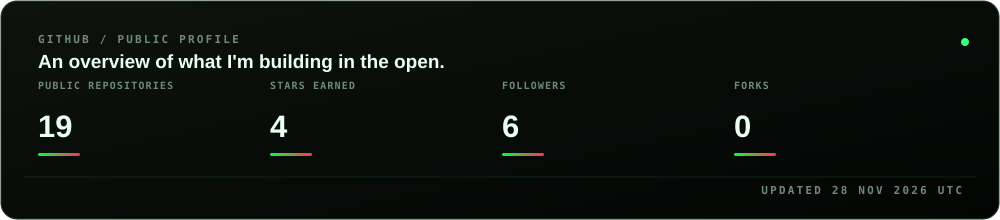

<pre>
┌───────────────────────────────────────────────────────────┐
│  MADHAV MANCHANDA                              PROFILE / 01 │
│  SOFTWARE · SYSTEMS · APPLIED AI                STATUS: ON  │
└───────────────────────────────────────────────────────────┘
</pre>

 

---

<pre>
madhav@github:~$ whoami
Computer Science student and hands-on builder focused on useful, reliable software.

madhav@github:~$ status
learning · designing · testing · shipping
</pre>

<code>./about --open</code>

 

I’m interested in the engineering behind clear, dependable products: application development, backend systems, data workflows, and lower-level problem solving. My approach is practical—understand the fundamentals, build something real, test the edges, then improve it.

I care about clear architecture, thoughtful user experience, maintainable code, and open-source collaboration.

<code>./stack --show</code>

 

| Layer | Working with |
|---|---|
| Languages | Python · C · C++ · Java · JavaScript · SQL |
| Backend & data | FastAPI · PostgreSQL · SQLite · Supabase · NumPy · Pandas |
| Systems & tools | Linux · Git · GitHub · VS Code · Android tooling |

<code>./learning --now</code>

 

- Reliable backend services and clear API boundaries
- Data structures, algorithms, and deliberate problem solving
- Applied machine learning and data analysis foundations
- Polished Android and web experiences
- Linux, networking, and system behaviour

<code>./repositories --browse</code>

 

## Live Profile Metrics

  

Automatically refreshed from public GitHub data.

## Activity Signal

  
  

  

  

## Contribution Stream

  

---

<code>madhav@github:~$ contact --open</code>

  

[Portfolio](https://www.madhav.world/) · [LinkedIn](https://www.linkedin.com/in/madhav-manchanda-0069a9356/) · [GitHub](https://github.com/madhav-manchanda) · [Email](mailto:madhavmanchanda18@gmail.com)

  

Curiosity · Craft · Continuous improvement

