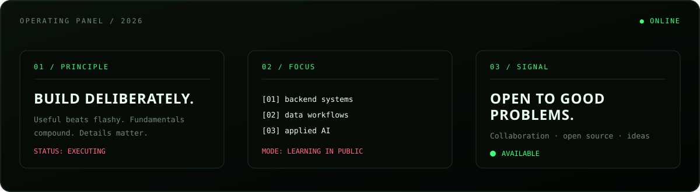

    

   

  

<a href="#about">ABOUT</a>  •  <a href="#environment">ENVIRONMENT</a>  •  <a href="#focus">FOCUS</a>  •  <a href="#builds">BUILDS</a>  •  <a href="#telemetry">TELEMETRY</a>  •  <a href="#contribution-stream">STREAM</a>

 

<code>01 / about</code>
<pre> $ cat profile.txt Computer Science student and hands-on builder. I work at the intersection of dependable software, backend systems, data workflows, and the engineering details that make products feel considered. </pre>

I learn by understanding the fundamentals, building something real, testing the edges, and improving the result. Clear architecture, thoughtful user experience, and maintainable code are the standard.

 

PROFILE DATA · LIVE INTENT · OPEN COLLABORATION

 

<code>02 / environment --inspect</code>

LOADED MODULES / TOOLCHAIN
 

Technical Skills

 <table> <tr> <td width="24%" valign="top">LANGUAGES  <code>Python</code> <code>C</code> <code>C++</code> <code>Java</code> <code>JavaScript</code> <code>SQL</code></td> <td width="38%" valign="top">BACKEND + DATA  <code>FastAPI</code> <code>PostgreSQL</code> <code>SQLite</code> <code>Supabase</code> <code>NumPy</code> <code>Pandas</code></td> <td width="38%" valign="top">SYSTEMS + TOOLS  <code>Linux</code> <code>Git</code> <code>GitHub</code> <code>VS Code</code> <code>Android tooling</code></td> </tr> </table> 

<code>03 / focus --now</code>

ACTIVE QUEUE / PRIORITY TASKS
 <pre> [01] Reliable backend services and clear API boundaries ████████░░ [02] Data structures, algorithms, and deliberate problem ███████░░░ [03] Applied machine learning and data analysis foundations ██████░░░░ [04] Polished Android and web experiences ██████░░░░ [05] Linux, networking, and system behaviour ███████░░░ </pre> 
  
 

<code>04 / builds --featured</code>

WHAT I'M MAKING / SIDE PROJECTS
 <table> <tr> <td width="50%" valign="top">

JARVIS  PERSONAL AI ASSISTANT

A personal AI assistant with a Python backend running on a VPS, with device-side execution on Android planned next.

<code>Python</code> <code>Backend</code> <code>Android</code> <code>AI</code>

<!-- Add your repo link: [**View repository →**](https://github.com/madhav-manchanda/REPO-NAME) --> </td> <td width="50%" valign="top">

NOTES-AI  STUDY NOTES PIPELINE

A multi-stage Python CLI that turns Udemy lectures into AI-generated study notes.

<code>Python</code> <code>CLI</code> <code>LLMs</code> <code>Automation</code>

<!-- Add your repo link: [**View repository →**](https://github.com/madhav-manchanda/REPO-NAME) --> </td> </tr> </table> 

<code>05 / telemetry --live</code>

PUBLIC SIGNAL / AUTO-REFRESHED
 
 LIVE GITHUB PROFILE METRICS · AUTOMATICALLY REFRESHED    
   <table> <tr> <td width="50%" align="center"> CONTRIBUTION SUMMARY    </td> <td width="50%" align="center"> CONSISTENCY SIGNAL    </td> </tr> </table> 
 LANGUAGE DISTRIBUTION    
   
 CONTRIBUTION ACTIVITY    
 

<code>06 / contribution-stream --watch</code>

AUTOMATED CONTRIBUTION VISUAL
 
 THE GRID IS GENERATED BY A SCHEDULED GITHUB ACTION    
   

<code>madhav@github:~$ contact --open</code>

  

Portfolio · LinkedIn · GitHub · Email

 
